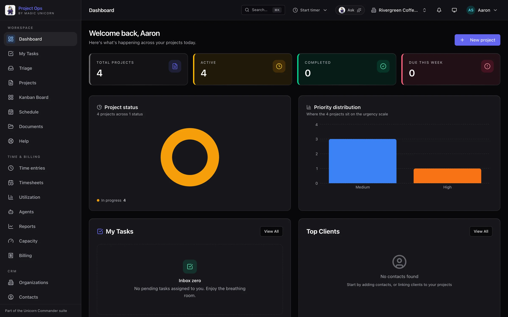
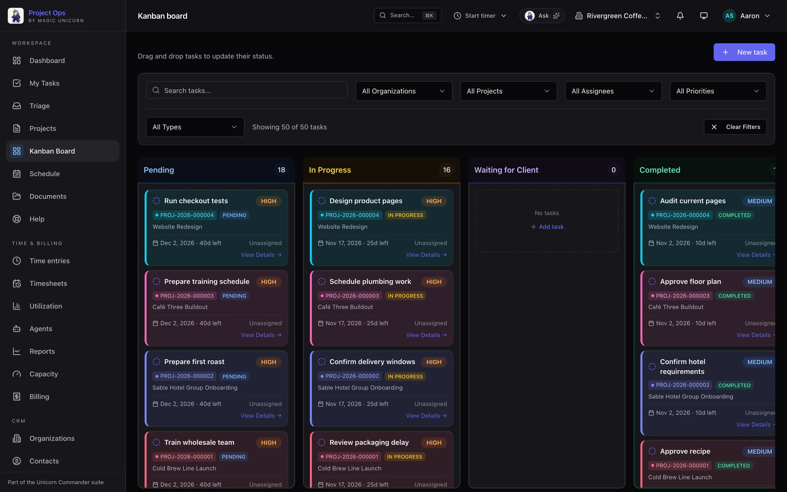
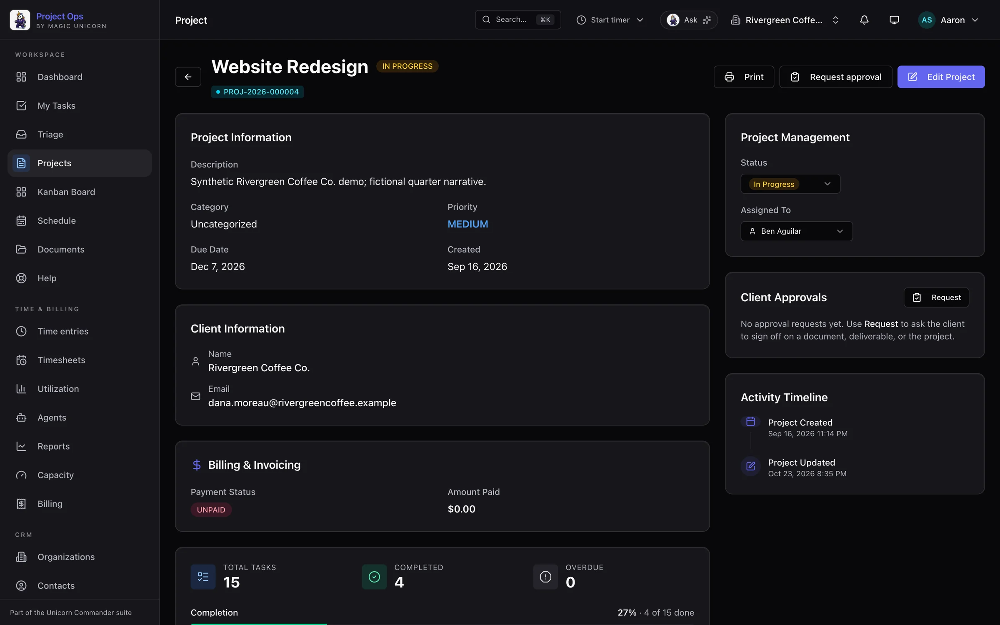
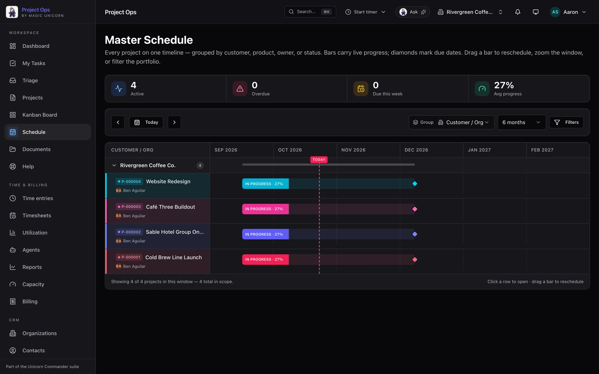
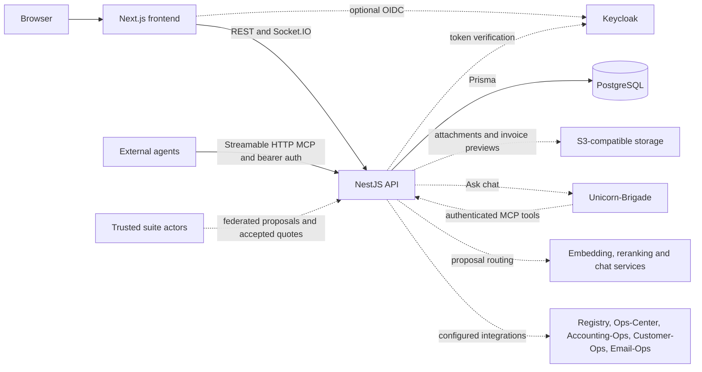

<div align="center">


# Project-Ops

**Projects, tasks, time and invoices — for people and the agents working with them.**

[](LICENSE)
[](CHANGELOG.md)
[](#architecture)
[](#quick-start)
[](#built-for-agents)

[Quick start](#quick-start) · [Features](#feature-tour) · [Agents](#built-for-agents) · [Architecture](#architecture) · [Suite](#part-of-unicorn-commander)

[Website](https://projectops.unicorncommander.ai) · [Documentation](docs/README.md) · [Changelog](CHANGELOG.md)

</div>

<p align="center">
  
</p>

## What is Project-Ops?

Project-Ops is a self-hosted workspace for teams managing projects, client work and the time that becomes an invoice. People review proposed actions and approve work; agents can read projects, update tasks, attach documents and log time through scoped MCP tools. Boards, schedules, client records and an agent activity ledger keep the work and its context together. It is part of Unicorn Commander, with optional shared identity, workspace records and integrations across the suite.

## Highlights

- **See the portfolio at a glance.** A dashboard, Kanban board and master schedule connect daily tasks to project status and deadlines.
- **Plan beyond a flat task list.** Subtasks, dependencies, recurring work and custom fields capture how a project actually runs.
- **Turn work into billable records.** Timers, manual entries, rates and timesheet approvals feed invoice previews and optional Accounting-Ops invoicing.
- **Review incoming action items.** Triage proposes a project and priority, checks for duplicates and keeps candidates separate from tasks until an approval action.
- **Give agents useful access.** MCP tools operate as the authenticated user, with workspace binding, token scopes and role checks on mutations.
- **Bring clients into the work.** A scoped portal supports approvals, comments, shared documents and read-only invoices. A due balance sets `payUrl` to a local portal path; that path is a checkout stub, not a payment URL from Accounting-Ops.
- **Start with infrastructure you control.** Docker provides local sign-in and a database; add your own Keycloak, object storage and agent services as needed.

## Feature tour

### A board for the work in front of you

<p align="center">
  
</p>

Drag tasks between statuses and narrow the board by organization, project, assignee or priority. **My Tasks** gathers assigned work by due date and highlights overdue items. Task details carry subtasks, comments and dependencies; completion checks expose unfinished blockers, and a workspace OWNER, ADMIN, or MANAGER can override them.

### The project, with its tasks, time and documents

<p align="center">
  
</p>

Keep tasks, a timeline, budget progress, documents and activity beside the project they belong to. Project snapshots summarize completion and task status; the printable view produces a status report. Documents use S3-compatible storage and include an in-app Markdown viewer. Projects originating from Customer-Ops can also show their accepted quote.

### Triage before commitment

<p align="center">
  
</p>

AI-proposed action items wait here for review: approve, reject, change the destination project or create a project from unassigned proposals. Ingest creates proposals, not tasks; applying an approval creates the task. Human review is the UI workflow, and authorized MCP clients can also record approval decisions through `rule_triage_proposals`.

### Agent work you can inspect

<p align="center">
  
</p>

The ledger records successful MCP actions with project context and duration. Those events leave token counts empty. Assistant turns record reported token usage, and their cost comes from model pricing: a configured free model is $0, and a missing or unpriced model is unknown. External agents' own inference bills are not measured by an MCP tool call, and event capture is best effort.

### The master schedule

<p align="center">
  
</p>

See projects on a shared timeline, grouped by customer, product, owner or status. Progress bars and due-date diamonds show what is moving and what is due; drag a project bar to reschedule. Portfolio, Profitability and Throughput reports add delivery and financial context, while capacity planning compares estimated committed hours with pro-rated weekly capacity and shows utilization bands.

### More of the operation, in the same workspace

| Area | What you can do |
|---|---|
| Planning | Set status, priority, categories and tags; use subtasks and dependencies with self-link and cycle guards. Schedule recurring tasks and projects using the supported daily, weekly and monthly RRULE subset, materialized by daily jobs. |
| Custom fields | Define workspace fields for projects and tasks: text, number, date, select, multiselect and boolean. |
| Time and billing | Start and stop timers, enter time manually, resolve bill and cost rates, submit timesheets and approve time. Combine approved, unbilled time and flat fees into a draft invoice and PDF preview. Issue and sync invoices in Accounting-Ops when `BILLABLE_ROLLUP_LIVE` is on and `ACCOUNTING_OPS_BASE_URL`, `ACCOUNTING_OPS_WORKSPACE_ID` and `ACCOUNTING_OPS_ENTITY_ID` are set. Previews need object storage. |
| Organizations and contacts | Maintain contacts, parent/child organizations and rollups alongside their projects. Customer-Ops and Contact-Ops reference fields let projects retain suite identifiers. |
| Client portal | Give authenticated client users access to their projects, explicitly shared documents, approvals and non-internal comments. Invoice views are read-only. When a balance is due and the invoice is not cancelled, the API sets `payUrl` to `/client-portal/invoices/:projectId/pay`. That value is a local checkout stub, not a URL from Accounting-Ops, and the portal has no page at that path. |
| Automation and webhooks | Build When → If → Then rules to assign tasks, change status, add comments, create tasks or notify users. Send HMAC-SHA256-signed webhooks with retries and a delivery log. |
| Everyday work | Use notifications, @mentions, WebSocket updates and the activity feed. Save views, star projects, pin tasks, apply bulk actions and export scoped CSV data. Choose light, dark, vibrant or system theme. |

The [feature guide](docs/FEATURES.md) covers the broader workflow. The dashboard also provides project-status and priority charts, upcoming deadlines, assigned tasks and a top-contacts view.

| Shortcut | Action |
|---|---|
| `⌘K` / `Ctrl+K` | Open the command palette |
| `⌘/` / `Ctrl+/` | Open the command palette with the alternate binding |
| `↑` / `↓` · `Enter` · `Esc` | Navigate · select · close |

<p align="center">
  
</p>

## Built for agents

The backend serves **stateless Streamable HTTP MCP** at `/api/v1/mcp`. It registers **64 tools** with the default feature settings; **12 time and billing tools** are omitted when `TIME_TRACKING_ENABLED` is disabled. Ask the running server for `tools/list` to discover its available tools.

Authenticate with `Authorization: Bearer <personal-access-token>` or an accepted user JWT. MCP rejects `CLIENT` accounts; clients use the curated portal. A Personal Access Token is bound to a workspace and grants selected scopes, while tool execution also checks the user's role and workspace permissions. A tool appearing in discovery does not mean the token may invoke it.

| Job | Useful tools |
|---|---|
| Understand the work | `list_my_projects`, `get_project`, `list_my_tasks`, `get_task`, `list_project_tasks`, `search_projects`, `get_recent_activity` |
| Move work forward | `create_project`, `create_task`, `update_task_status`, `add_task_comment`, `add_task_dependency`, `list_task_subtasks` |
| Bring evidence | `list_project_documents`, `get_document_content`, `upload_document` |
| Propose and review | `submit_candidate_action_items`, `list_triage_proposals`, `rule_triage_proposals`, `request_approval` |
| Account for effort | `start_timer`, `stop_timer`, `log_time`, `submit_timesheet`, `approve_time`, `create_billable_draft` |
| Plan and administer | `get_portfolio_report`, `get_team_capacity`, `create_automation`, `list_members`, `invite_member` |

These are real read and write operations. Task creation, status changes and authorized triage decisions do not all pass through a separate human approval gate. Start with only the scopes an agent needs, such as `read:projects` and `read:tasks`, and add write access deliberately.

### Connect an MCP client

Complete the [local quick start](#quick-start), then follow the [PAT creation recipe](docs/MCP_FOR_CODING_AGENTS.md#create-an-expiring-pat-on-localhost). It uses a signed-in session with `POST /api/v1/auth/pats`; a PAT cannot mint another PAT. Tokens use the `po_pat_` prefix. Set `expiresAt` explicitly: omitting it creates a non-expiring token. Save the returned `plaintext` token when it is shown, and keep it in your client's private configuration or secret store.

For clients accepting an `mcpServers` configuration with HTTP transport:

```json
{
  "mcpServers": {
    "project-ops": {
      "type": "http",
      "url": "http://127.0.0.1:3201/api/v1/mcp",
      "headers": {
        "Authorization": "Bearer <personal-access-token>"
      }
    }
  }
}
```

Replace the placeholder locally. A client running on another machine needs your own HTTPS API address in place of the loopback URL. The [MCP guide](docs/MCP_FOR_CODING_AGENTS.md) also covers scope discovery and token revocation. The server implementation and scope map are in [mcp.service.ts](backend/src/mcp/mcp.service.ts) and [pat.constants.ts](backend/src/auth/pat/pat.constants.ts).

### Assistant and agent hooks

The dashboard's **Ask** sidebar sends chat to a configured Unicorn-Brigade agent. Set the backend's `BRIGADE_URL`, `BRIGADE_API_KEY` and `BRIGADE_AGENT_ID`, and configure that agent's tools and model in Brigade. The proxy sends a user identifier and conversation context; MCP access is authenticated separately. Model hosting and data routing depend on that deployment. The standalone profile leaves the Brigade connection unconfigured.

Suite applications can submit candidate work to `POST /api/v1/triage/ingest` through the configured federation trust path. This ingress requires an allowlisted machine actor and creates proposals for review. Accepted Customer-Ops quotes have a separate authenticated federation route that creates the project, line-item tasks and accepted PDF. Outbound webhooks provide signed event delivery for other integrations.

## Quick start

**Prerequisites:** Docker with Compose v2, and an interactive terminal. Run these commands from the root of this repository. This profile builds the application from this checkout and uses local email/password sign-in; it does not require Keycloak or a suite account. The published [project-ops-community](https://github.com/Unicorn-Commander/project-ops-community) repository is a separate community edition under AGPL-3.0; it is not this Apache-2.0 tree.

```bash
cp .env.example .env
docker compose -f docker-compose.selfhost.yml up -d --build
curl --retry 60 --retry-delay 2 --retry-connrefused -fsS http://127.0.0.1:3201/api/v1/health/live
curl -fsS http://127.0.0.1:3201/api/v1/health/ready
```

After readiness succeeds, run the bootstrap in a private interactive terminal. **Do not redirect, tee or record its output.**

```bash
docker compose -f docker-compose.selfhost.yml exec backend node dist/selfhost/bootstrap.js
```

The bootstrap creates a local `ADMIN`, a workspace and an active `OWNER` membership. It displays a generated login email, password and bcrypt hash once. The address is `admin-` plus 24 hex characters at `example.invalid`. That address is a login identifier, not a mailbox. Save the email and password in your password manager, then open **[Project-Ops on localhost](http://127.0.0.1:3200/auth/login)** and use the email/password form. Sign in with the password, not its hash. Change the password at `/auth/change-password` after signing in.

Create a project and a task, then open the board and schedule to explore. The [local API documentation](http://127.0.0.1:3201/api/v1/docs) describes the REST surface. First-build time depends on image downloads and available resources.

### What the local profile includes

| Ready after bootstrap | Requires additional configuration |
|---|---|
| Local sign-in, projects, tasks, dashboard, board and schedule | Keycloak for optional OIDC sign-in |
| Time tracking, timesheets and reporting | S3-compatible storage for attachments and invoice PDF previews |
| Authenticated MCP tools and workspace-bound PATs | Brigade for the Ask assistant; inference endpoints for AI triage routing |
| Local records and application notifications | SMTP or Email-Ops for email; Accounting-Ops for live invoicing; registry and entitlement services for suite deployment |

Docker publishes the UI on `127.0.0.1:3200` and the API on `127.0.0.1:3201`. The processes listen on `0.0.0.0` inside their containers. PostgreSQL and Redis have no published host ports. The Compose profile is for **a single workspace on a single machine**: the runtime role is non-superuser `project_ops_app` with `NOBYPASSRLS`, but this profile does **not** install the multi-workspace RLS policies and sets `PROJECT_OPS_TENANCY_ENABLED=false`. Database tenant isolation requires a separately configured deployment.

Attachments require a reachable S3-compatible service, such as Garage, configured through `MINIO_*`. `MINIO_ENDPOINT` must be reachable from the backend container, and `MINIO_PUBLIC_*` must be reachable from the browser; container loopback is not the host's storage service. Without storage, its initialization and integration checks can report unavailable while API liveness and database readiness remain usable.

### Keep the installation recoverable

The init service creates database passwords, `JWT_SECRET`, a persistent `EMAIL_ENCRYPTION_KEY`, a workspace ID and the local admin identity in the `selfhost_config` Docker volume. Database and Redis data have their own named volumes. `.env` contains optional settings and is ignored by Git. **Back up the configuration and database volumes together**; losing the configuration volume loses encryption keys and database access.

Bootstrap refuses an unrelated existing installation. Repeating it does not reset or reveal the admin password, and only its hash is stored in the database. Bootstrap writes no admin password file. A failure prints a generic error and does not log the credentials. If the terminal closes after the transaction commits but before you save the password, recovery requires a deliberate database-admin password reset.

Schema initialization uses the repository's `prisma db push` workflow, without accepting destructive changes automatically or running legacy seed data. Review schema changes before upgrading an existing installation. The [schema](backend/prisma/schema.prisma), [startup code](backend/src/selfhost/start.ts) and [release history](CHANGELOG.md) are the relevant references.

### Optional Keycloak sign-in

In the root `.env`, set `PROJECT_OPS_AUTH_MODE=oidc` and configure `KEYCLOAK_URL`, `KEYCLOAK_REALM`, `KEYCLOAK_CLIENT_ID` and `KEYCLOAK_CLIENT_SECRET` for your own service. Register `http://127.0.0.1:3201/api/v1/auth/keycloak/callback` as the redirect URI. Define first-login access explicitly:

```dotenv
PROJECT_OPS_ACCESS_LIST=<owner-email>:ADMIN,*@<your-domain>:STAFF
```

Replace both placeholders. Exact email rules take precedence over domain rules, and unmatched first-time users are denied. With a blank list, the self-host entrypoint substitutes only the generated bootstrap identity; outside that entrypoint, a missing list grants no first-login access. Local password sign-in remains available.

Rebuild to update the browser's sign-in options:

```bash
docker compose -f docker-compose.selfhost.yml up -d --build
```

## Run from source

For development, complete the Docker quick start first so the database, schema and local account exist. Use **Node.js 20** and npm for the frontend, matching the repository's build images and CI. The backend and data services can stay in Docker while Next.js reloads your frontend edits.

From the repository root:

```bash
docker compose -f docker-compose.selfhost.yml stop frontend
cd frontend
npm ci
NEXT_PUBLIC_API_URL=http://127.0.0.1:3201/api/v1 \
NEXT_PUBLIC_AUTH_MODE=local \
npm run dev -- --hostname 127.0.0.1 --port 3200
```

Use the same [local sign-in page](http://127.0.0.1:3200/auth/login). The API URL includes `/api/v1`, and the frontend origin stays aligned with the backend's CORS configuration.

For backend source changes, open another terminal **at the repository root**. The self-host build stage includes the TypeScript toolchain. Mount the source, rebuild it in that container and start it with the existing configuration volume:

```bash
docker compose -f docker-compose.selfhost.yml stop backend
docker compose -f docker-compose.selfhost.yml run --rm --no-deps --service-ports --user 0:0 \
  --volume "$PWD/backend/src:/app/src:ro" \
  backend sh -c 'npm run build && node dist/selfhost/start.js'
```

The temporary container builds as root so it can replace the image's compiled files; the source mount is read-only. Generated credentials stay inside the existing Docker volume. Restart this command to compile further backend edits; it is not a watch process. Changes to dependencies or the Prisma schema require rebuilding the backend image. To return to the normal stack, stop the development processes, return to the repository root and run the Compose build/up command again.

## Configuration

The root [`.env.example`](.env.example) links to [the self-host template](infrastructure/docker/.env.example). Copy it to `.env` at the repository root. It contains the settings supported directly by `docker-compose.selfhost.yml`:

| Variable | Meaning |
|---|---|
| `PROJECT_OPS_AUTH_MODE` | Select local authentication or enable the optional OIDC sign-in path. |
| `PROJECT_OPS_ACCESS_LIST` | First-login email/domain rules and assigned roles for OIDC users. |
| `KEYCLOAK_URL` | Base URL of your Keycloak service. |
| `KEYCLOAK_REALM` | Realm used for authentication. |
| `KEYCLOAK_CLIENT_ID` | Client registered for Project-Ops. |
| `KEYCLOAK_CLIENT_SECRET` | Credential for that OIDC client. |
| `MINIO_ENDPOINT`, `MINIO_PORT`, `MINIO_USE_SSL` | S3-compatible endpoint reached by the backend. |
| `MINIO_ACCESS_KEY`, `MINIO_SECRET_KEY` | Object-storage credentials. |
| `MINIO_BUCKET_NAME` | Bucket used for document storage. |
| `MINIO_PUBLIC_ENDPOINT`, `MINIO_PUBLIC_PORT`, `MINIO_PUBLIC_USE_SSL` | Browser-reachable endpoint used for signed downloads. |

The [backend template](backend/.env.example) also documents settings for custom and suite deployments. These are **backend process settings**; adding them to the root `.env` does not automatically pass them through the self-host Compose file. Supply them through your deployment's backend environment.

| Variable | Meaning |
|---|---|
| `DATABASE_URL` | Runtime PostgreSQL connection; schema administration uses a separate connection. |
| `NODE_ENV`, `PORT`, `LOG_LEVEL` | Runtime mode, listening port and log verbosity. |
| `JWT_SECRET`, `JWT_EXPIRATION` | Signing secret and lifetime for local sessions. |
| `EMAIL_ENCRYPTION_KEY` | Persistent encryption key for stored email credentials. |
| `CORS_ORIGIN`, `FRONTEND_URL` | Browser origin and frontend redirect destination. |
| `KEYCLOAK_ENFORCE_AUDIENCE`, `KEYCLOAK_EXPECTED_AUDIENCES`, `KEYCLOAK_MAX_TOKEN_LIFETIME_SECONDS` | Accepted token audiences and lifetime constraints. |
| `SMTP_HOST`, `SMTP_PORT`, `SMTP_SECURE`, `SMTP_USER`, `SMTP_PASSWORD`, `SMTP_FROM_NAME`, `SMTP_FROM_ADDRESS` | Direct email delivery and sender settings. |
| `BRIGADE_URL`, `BRIGADE_API_KEY`, `BRIGADE_AGENT_ID` | Assistant service, authentication and agent selection. |
| `INFINITY_EMBEDDINGS_URL`, `INFINITY_RERANK_URL`, `INFINITY_EMBED_MODEL`, `INFINITY_RERANK_MODEL`, `QWEN_URL`, `QWEN_MODEL` | Embedding, reranking and chat inference used to route triage proposals. |
| `UC_REGISTRY_URL`, `UC_REGISTRY_TIMEOUT_MS` | Optional shared workspace registry and request timeout. |
| `PROJECT_OPS_ENTITLEMENTS_ENABLED`, `UC_ENTITLEMENTS_URL`, `PROJECT_OPS_FEATURE_KEY` | Optional Ops-Center entitlement check for interactive SSO login. |
| `PROJECT_OPS_ENTITLEMENTS_FAIL_OPEN`, `PROJECT_OPS_ENTITLEMENTS_ALLOWLIST_FALLBACK`, `UC_ENTITLEMENTS_TIMEOUT_MS` | Entitlement failure handling, allowlist fallback and timeout. |
| `PROJECT_OPS_FEDERATION_ACTORS` | Machine actors permitted on designated federation ingress routes. |
| `CUSTOMER_OPS_BASE_URL`, `CUSTOMER_OPS_SERVICE_TOKEN`, `CUSTOMER_OPS_TIMEOUT_MS` | Read-through connection for accepted-quote summaries. |
| `QUOTES_PDF_ALLOWED_ORIGINS` | Additional origins from which accepted quote PDFs may be fetched. |

Some integration controls live in code rather than the templates. [Feature flags](backend/src/common/workspace/feature-flags.ts) define `TIME_TRACKING_ENABLED` (default on), `BILLABLE_ROLLUP_LIVE` (default off) and `PROJECT_OPS_TENANCY_ENABLED` (default off). Live invoicing in the [Accounting-Ops client](backend/src/time-tracking/billing/http-accounting-ops.client.ts) needs `BILLABLE_ROLLUP_LIVE` plus `ACCOUNTING_OPS_BASE_URL`, `ACCOUNTING_OPS_WORKSPACE_ID` and `ACCOUNTING_OPS_ENTITY_ID`. The [Email-Ops client](backend/src/email-ops/http-email-ops.client.ts) delivers notification mail when `EMAIL_OPS_BASE_URL` and `EMAIL_OPS_SERVICE_TOKEN` are set: `send` for a non-CLIENT workspace member, and `draft` otherwise. When those settings are unset, notification mail stays on SMTP. [Assistant pricing](backend/src/assistant/assistant-pricing.ts) supports `ASSISTANT_TOKEN_PRICES` for model cost attribution. `BRAND_OPS_URL` optionally supplies UI color tokens.

## Architecture



- **Frontend:** Next.js 15, React 19, Tailwind CSS 4 and Radix components. The dashboard and client portal call the backend and subscribe to real-time events.
- **Backend:** NestJS 10 services expose REST and MCP, validate input, apply permissions and emit application events. Prisma 5 models the PostgreSQL 17 database in [`backend/prisma/schema.prisma`](backend/prisma/schema.prisma).
- **Identity and tenancy:** Local accounts support the standalone install; Keycloak adds OIDC. Application roles are `ADMIN`, `MANAGER`, `STAFF` and `CLIENT`. Workspace membership and database RLS support multi-workspace deployments when configured with the required policies and a `NOBYPASSRLS` runtime role. The startup role guard rejects a role carrying `BYPASSRLS` when tenancy is enabled.
- **Storage:** An S3-compatible service stores documents and invoice previews. The `MINIO_*` variable names are retained for compatibility, including when the service is Garage.
- **Supporting services:** Compose provisions Redis 7, but the backend currently has no Redis client wiring; the diagram shows the active application connections. The optional agent and suite integrations use the endpoints configured by the operator.

Health endpoints distinguish process liveness, database readiness and integration status:

| Endpoint | Purpose |
|---|---|
| `GET /api/v1/health/live` | Process liveness |
| `GET /api/v1/health/ready` | Database readiness |
| `GET /api/v1/health` | Database and memory checks |
| `GET /api/v1/health/integrations` | Database, Keycloak, Brigade, registry and storage status as `ok`, `down` or `not_configured` |
| `GET /api/v1/health/mcp-metrics` | Process-local MCP call outcomes and latency |

## Part of Unicorn Commander

| App | What it does |
|---|---|
| Unicorn-Brigade | Ask chat, when `BRIGADE_URL`, `BRIGADE_API_KEY` and `BRIGADE_AGENT_ID` are set. The self-host profile leaves `BRIGADE_URL` empty. |
| Ops-Center | Optional entitlement check on interactive SSO, when `PROJECT_OPS_ENTITLEMENTS_ENABLED` and `UC_ENTITLEMENTS_URL` are set. |
| [Accounting-Ops](https://github.com/Unicorn-Commander/accounting-ops-oss) | Invoice issue and status sync when live billing is enabled. Also published as [accounting-ops-community](https://github.com/Unicorn-Commander/accounting-ops-community). |
| [Contact-Ops](https://github.com/Unicorn-Commander/contact-ops-community) | Optional `contactOpsContactId` on a project. The published repository describes the suite's shared contact and identity layer. |
| [Customer-Ops](https://github.com/Unicorn-Commander/customer-ops-community) | Accepted quotes from the allowlisted `customer-ops` actor, plus `customerOpsCustomerId` on a project. The published repository describes the customer relationship and pipeline layer. |
| [Email-Ops](https://github.com/Unicorn-Commander/email-ops-community) | Optional notification delivery. The published repository describes agent-governed email with a human approval inbox. |
| **Project-Ops** | **This repository: projects, tasks, time and invoices, under Apache-2.0.** The published [project-ops-community](https://github.com/Unicorn-Commander/project-ops-community) repository is a separate AGPL-3.0 community edition. |
| [Meeting-Ops](https://github.com/Unicorn-Commander/Meeting-Ops-OSS) | Documented triage-ingest actor (`meeting-ops`). The published repository describes browser recording, live transcription and meeting search. |
| Brand-Ops | Optional color tokens from `BRAND_OPS_URL`. The UI keeps its own stylesheet when that service is unset. |

Ask chat goes to Brigade when that connection is configured. Federation is a separate allowlisted machine actor: triage ingest accepts any actor on `PROJECT_OPS_FEDERATION_ACTORS`, and accepted quotes accept only `customer-ops`. Ops-Center is the optional SSO entitlement check. Accounting-Ops issues and syncs invoices when live billing is configured. Email-Ops can deliver notifications. Projects can store Contact-Ops and Customer-Ops ids. Brand-Ops can override color tokens.

## Development

Contributions are welcome; start with [CONTRIBUTING.md](CONTRIBUTING.md). Run backend checks from `backend/` with Node.js 20 and npm:

```bash
cd backend
npm ci
npm run prisma:generate
npx eslint "{src,apps,libs,test}/**/*.ts" --max-warnings 0
npm run build
npm test -- --ci --runInBand
```

The direct ESLint command matches CI and leaves files unchanged; `npm run lint` is also available but applies fixes. To exercise workspace isolation against a disposable PostgreSQL database, use the existing Docker test runner after installing backend dependencies:

```bash
# Run from backend/ with Docker running.
npm run test:rls:run
```

That runner creates and removes its test database container, applies tenancy policies, and runs the workspace-isolation, invitation and public-user integration checks. Use a development machine; do not substitute a live database. Additional integration tests use the checked-in [`tests/jest-integration.json`](backend/tests/jest-integration.json) and require their fixtures.

In another terminal, run frontend checks from the repository root:

```bash
cd frontend
npm ci
npm run lint
npm run build
```

CI runs those two scripts and then `npx tsc --noEmit`.

### Documentation and release history

| Reference | Contents |
|---|---|
| [Documentation index](docs/README.md) | The repository's guides and operating notes |
| [Feature guide](docs/FEATURES.md) | Product workflows and feature detail |
| [Assistant guide](docs/AI_ASSISTANT.md) | Ask sidebar usage and deployment context |
| [MCP guide](docs/MCP_FOR_CODING_AGENTS.md) | Local agent access, expiring PATs, scopes and revocation |
| [Changelog](CHANGELOG.md) | Release history and unreleased changes |

The package manifests declare the version shown above. Release notes follow Semantic Versioning and Keep a Changelog; unreleased changes are recorded separately in the changelog.

## Security

Report vulnerabilities privately using the process in [SECURITY.md](SECURITY.md). Keep credentials, client records and production exports out of issues and pull requests.

The backend uses authenticated role and workspace checks, scoped MCP operations and audit records. Multi-workspace database isolation also depends on the deployed RLS policies and runtime role; the local quick start does not enable it. Agent activity capture complements the audit log and is not a complete record of every attempted operation.

Rate limiting separates the `short`, `long` and `mcp` tiers. Authenticated requests are bucketed by verified PAT id, or by the user's `__ucUid`, Keycloak id, or user id. For unauthenticated traffic, `CF-Connecting-IP` is used, and otherwise the first `X-Forwarded-For` address, only when the immediate peer is a trusted proxy. `TRUSTED_PROXY_CIDRS` overrides the default ranges `10.0.0.0/8`, `172.16.0.0/12`, `192.168.0.0/16`, `127.0.0.0/8`, `::1/128` and `fc00::/7`. A CIDR in that setting is trusted as written, including an unbounded one; forwarded headers from an untrusted peer are ignored. See the [throttler guard](backend/src/common/guards/principal-throttler.guard.ts).

## Licence

Project-Ops is licensed under the **[Apache License 2.0](LICENSE)**. The frontend and backend package metadata both declare `Apache-2.0`. See the licence for its permissions, conditions and warranty disclaimer.

© 2026 Magic Unicorn Unconventional Technology & Stuff Inc.

Built by [Magic Unicorn](https://magicunicorn.tech) · part of [Unicorn Commander](https://unicorncommander.ai)
